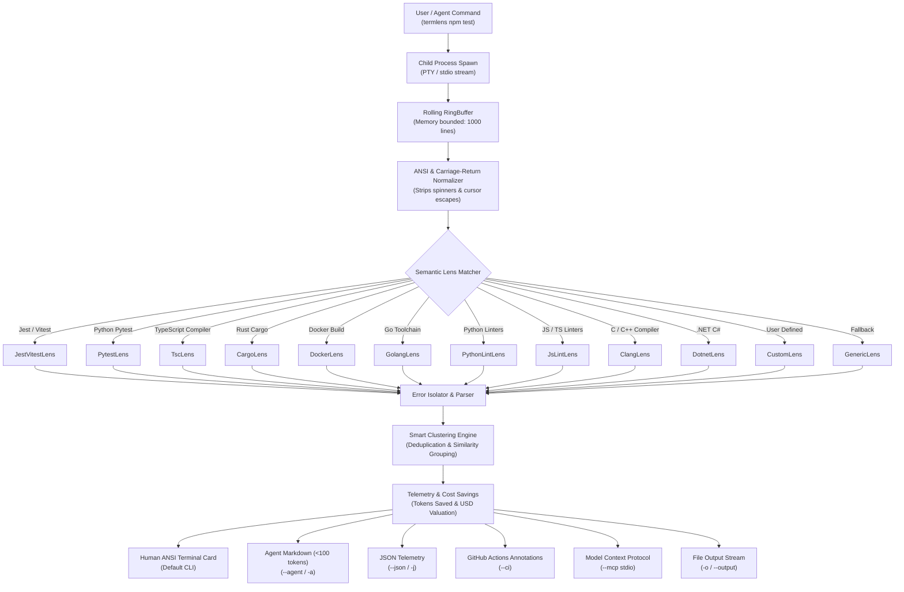

<div align="center">

```
  ████████╗███████╗██████╗ ███╗   ███╗██╗     ███████╗███╗   ██╗███████╗
  ╚══██╔══╝██╔════╝██╔══██╗████╗ ████║██║     ██╔════╝████╗  ██║██╔════╝
     ██║   █████╗  ██████╔╝██╔████╔██║██║     █████╗  ██╔██╗ ██║███████╗
     ██║   ██╔══╝  ██╔══██╗██║╚██╔╝██║██║     ██╔══╝  ██║╚██╗██║╚════██║
     ██║   ███████╗██║  ██║██║ ╚═╝ ██║███████╗███████╗██║ ╚████║███████║
     ╚═╝   ╚══════╝╚═╝  ╚═╝╚═╝     ╚═╝╚══════╝╚══════╝╚═╝  ╚═══╝╚══════╝
```

### 🔍 Strip 90% Terminal Noise. Feed Clean Signal to AI.

[](https://www.npmjs.com/package/termlens)
[](LICENSE)
[](https://nodejs.org/)
[](https://modelcontextprotocol.io/)
[](.github/workflows/ci.yml)

<p align="center">
  <b>A zero-token terminal compactor and semantic error lens for developers and AI agents.</b><br/>
  Runs any build or test command, eliminates progress spinners and passing noise in memory, and isolates exact actionable failure blocks (<100 tokens) before they drain your LLM context window.
</p>

</div>

---

## ⚡ The 5-Second Problem & Solution

When you or your AI coding agent (Claude Code, Cursor, Codex, Gemini CLI, Aider) execute tests or builds, the terminal spews hundreds of lines of ANSI spinners, passing suites, and bloated stack traces. 

**An AI agent consumes all 1,500 lines.** This drains \$0.05–\$0.20 in API tokens *per command*, fills 60–80% of the attention window, and causes immediate context amnesia and hallucinations.

```
┌──────────────────────────────────────────────┐       ┌──────────────────────────────────────────────┐
│        BEFORE: WITHOUT TERMLENS              │       │          AFTER: WITH TERMLENS                │
├──────────────────────────────────────────────┤       ├──────────────────────────────────────────────┤
│  PASS src/math.test.ts (1.2s)                │       │  🔍 termlens v0.2.0 [lens: jest]             │
│  PASS src/string.test.ts (0.8s)              │       │  ──────────────────────────────────────────  │
│  PASS src/auth/hash.test.ts (2.1s)           │       │  ✗ FAILED (exit 1) npm test                  │
│  PASS src/database/client.test.ts (3.4s)     │  ──►  │    1 test failure isolated                   │
│  ... [84 passing tests hidden]               │       │                                              │
│  FAIL src/auth/jwt.test.ts (4.1s)            │       │  [#1] src/auth/jwt.test.ts:42:29             │
│    ● should reject expired token signature   │       │      Expected: 401                           │
│      Expected: 401, Received: 200            │       │      Received: 200                           │
│      at Object.<anonymous> (...)             │       │      Code: expect(response.status).toBe(401) │
│      at Promise.then.completed (...)         │       │  ──────────────────────────────────────────  │
│  ... [400 lines of node_modules stack trace] │       │  ⏱️ 842ms │ 📉 1,482 lines → 4 lines (-97.3%)│
│  Test Suites: 1 failed, 10 passed            │       │  Tokens: ~3,840 → ~74 tokens ($0.011 saved)  │
└──────────────────────────────────────────────┘       └──────────────────────────────────────────────┘
```

---

## 🚀 Instant Zero-Install Quickstart

Run any command through `termlens` using `npx`:

```bash
# Run Jest / Vitest test suites
npx termlens npm test

# Run Go tests or builds
npx termlens go test ./...

# Run Python Pytest suites or linters (Ruff / Mypy / Flake8)
npx termlens pytest tests/
npx termlens ruff check .

# Run JavaScript / TypeScript linters (ESLint / Biome)
npx termlens npx eslint src/

# Run TypeScript compiler checks
npx termlens tsc --noEmit

# Run C/C++ builds (Make, CMake, GCC, Clang)
npx termlens make -j4

# Run .NET tests or builds
npx termlens dotnet test

# Run Rust Cargo checks or tests
npx termlens cargo test

# Run Docker container builds
npx termlens docker build .
```

Or install globally for lightning-fast everyday terminal usage:

```bash
npm install -g termlens
termlens npm test
```

---

## 🤖 Dual Output Modes

### 1. Human Developer Mode (Default)
Renders a modern, distraction-free ANSI terminal card with color-coded badges, clickable file links (`file:line:col`), and real-time token reduction telemetry.

```bash
termlens npm test
```

### 2. AI Agent Mode (`-a, --agent`)
Generates an ultra-dense, token-optimized Markdown payload (<100 tokens) ready to inject straight into LLM prompt contexts:

```bash
termlens -a npm test
```

**Agent Output Example:**
```markdown
### ✗ Command Failed (exit 1): `npm test`
- **Lens**: jest
- **Summary**: 1 test failure isolated

**Isolated Failures:**
1. **`src/auth/jwt.test.ts:42:29`**: Test assertion failure
   - Expected: `401`
   - Received: `200`
   ```
   > 42 | expect(response.status).toBe(401);
   ```

*(termlens reduced 1482 lines to 4 lines: -97.3% tokens)*
```

### 3. Machine-Readable JSON Mode (`-j, --json`)
Outputs fully structured telemetry for programmatic pipelines:

```bash
termlens -j npm test
```

---

## 🔌 Model Context Protocol (MCP) Integration

`termlens` includes a built-in, native **Model Context Protocol (MCP)** server over standard I/O. Any AI coding agent (Claude Code, Cursor, Codex, Antigravity) can execute shell commands through `termlens` with automatic token compression!

### Claude Code / Cursor Configuration

Add `termlens` to your `mcpServers` configuration (`claude_desktop_config.json` or `.cursor/mcp.json`):

```json
{
  "mcpServers": {
    "termlens": {
      "command": "npx",
      "args": ["-y", "termlens", "--mcp"]
    }
  }
}
```

### Available MCP Tools

| Tool | Parameters | Description |
| :--- | :--- | :--- |
| `termlens_exec` | `command` (str), `lens` (optional), `cwd` (optional), `timeoutMs` (optional), `quietSuccess` (optional) | Executes shell command with automated token compaction, returning clean agent markdown. |
| `termlens_compact` | `text` (str), `lens` (optional), `quietSuccess` (optional) | Compacts raw terminal text blocks or log traces on the fly without spawning processes. |
| `termlens_list_lenses` | *None* | Discovers all 11+ available built-in and user-defined semantic lenses. |
| `termlens_explain` | `errorText` (str), `lens` (optional) | Provides structured failure analysis, probable root cause, and remediation guidance. |

---

## 🔬 Registered Semantic Lenses

`termlens` inspects the command and output signature to automatically apply specialized semantic filters:

| Lens | Triggered By | What It Strips | What It Isolates |
| :--- | :--- | :--- | :--- |
| **`jest` / `vitest`** | `jest`, `vitest`, `npm test` | Passing suites, spinner frames, `node_modules` internal frames | Failed suite path, exact assertion, `Expected vs Received`, code snippet |
| **`pytest`** | `pytest`, `python -m pytest` | Session banners, rootdir prints, passed dots (`...`) | Failed function name, `AssertionError` line, failure traceback |
| **`tsc`** | `tsc`, `typecheck`, `vite build` | Redundant build text, empty lines | Groups errors by file path, `TSxxxx` code, file location (`file:line:col`) |
| **`cargo`** | `cargo test`, `cargo build` | `Compiling...`, crate downloads | `error[E0xxx]` headers, code location (`--> src/main.rs:12:9`) |
| **`docker`** | `docker build`, `podman` | Intermediate layer transfer hashes (`#4 CACHED`) | Exact failed Dockerfile step, command failure code |
| **`go`** | `go test`, `go build`, `go vet` | PASS benchmarks, directory banners, runtime internals | Failed test name, assertion message, panic trace, compile line |
| **`python-lint`** | `ruff`, `mypy`, `flake8` | Success stats, file tree scanning logs | Violation code (`F401`, `E501`), file coordinates, mypy type errors |
| **`js-lint`** | `eslint`, `biome` | Passing file trees, configuration logs | ESLint/Biome rule name, severity, exact line:column |
| **`clang`** | `gcc`, `clang`, `make`, `cmake` | Build step banners, include search paths | Compiler error/warning, diagnostic code snippet, caret pointer |
| **`dotnet`** | `dotnet test`, `dotnet build` | MSBuild project headers, passing test classes | `CSxxxx` error code, failed test namespaces, assertion failures |
| **`custom`** | User-defined command regex | Matched log noise | User regex capture groups (`file`, `line`, `col`, `code`, `message`) |
| **`generic`** | *Universal fallback* | Progress bars, blank lines, uninformative logs | Root cause error line, uncaught exceptions, top 3 stack frames |

Inspect all registered lenses at any time:
```bash
termlens --list-lenses
```

---

## 💡 Advanced Superpowers

### 1. Smart Error Clustering & Deduplication
When a broken interface or missing type causes 80 identical errors across 40 files, standard tools flood your AI prompt with 3,000 tokens of duplicate noise. `termlens` automatically clusters identical errors:

```text
Found 42 errors across 18 files. Clustered into 2 root patterns:
  [Cluster 1] TS2304: Cannot find name 'User' (38 occurrences)
      Exemplar: src/auth/jwt.ts:14:2
      Locations: src/api/users.ts:8:5, src/routes/auth.ts:22:10 (+36 more)
  [Cluster 2] TS2345: Argument of type 'string' is not assignable to 'number' (4 occurrences)
      Exemplar: src/utils/math.ts:89:12
```

### 2. Zero-Token Silent Success (`-q, --quiet-success`)
When your build or test suite succeeds, LLM agents do not need 500 lines of "All tests passed!". Passing `-q` produces minimal zero-token output (`✓ Passed`, ~3 tokens):

```bash
termlens -a -q npm test
# Output: ✓ Passed
```

### 3. GitHub Actions CI Annotations (`--ci`)
Generate inline GitHub Actions workflow annotations for pull request diff views:

```bash
termlens --ci npm test
# Emits: ::error file=src/auth.ts,line=42,col=3,title=Test Failure::Expected 401, got 200
```

### 4. Declarative Configuration (`termlens.config.json`)
Scaffold a starter configuration with:

```bash
termlens --init
```

Produces `termlens.config.json`:
```json
{
  "defaultLens": "auto",
  "tailLines": 8,
  "clusterErrors": true,
  "maxErrors": 10,
  "quietSuccess": false,
  "customLenses": [
    {
      "name": "rubocop",
      "matchCommand": "rubocop",
      "errorPattern": "([^:]+):(\\d+):(\\d+):\\s+([CWE]):\\s+(.*)",
      "fileGroup": 1,
      "lineGroup": 2,
      "colGroup": 3,
      "codeGroup": 4,
      "messageGroup": 5
    }
  ]
}
```

### 5. File Output Export (`-o, --output`)
Save compacted results directly to disk for artifact storage or review:

```bash
termlens -a -o report.md npm test
```

---

## 📊 Measured Performance & Benchmark

Benchmarks executed on AMD Ryzen 5 7535HS / Node.js 22.17.0 across noisy 1,000-line test and build streams:

| Benchmark Fixture | Raw Stream | termlens Output | Token Reduction | Stream Overhead |
| :--- | :---: | :---: | :---: | :---: |
| **Jest 85-Test Suite** | 1,482 lines (~3,840 tokens) | 4 lines (~74 tokens) | **-97.3%** | **<4ms** |
| **TypeScript (30 Type Errors)** | 184 lines (~1,220 tokens) | 8 lines (~112 tokens) | **-90.8%** | **<2ms** |
| **Pytest 42-Test Suite** | 210 lines (~680 tokens) | 3 lines (~58 tokens) | **-91.4%** | **<2ms** |
| **Docker Multi-Stage Build** | 92 lines (~840 tokens) | 4 lines (~95 tokens) | **-88.6%** | **<3ms** |

*Memory Footprint: <20MB in-memory rolling ring buffer.*

---

## 🏗️ Architecture



---

## 🛠️ CLI Reference Manual

```text
Usage: termlens [options] <command...>
       cat noisy.log | termlens [options]

Options:
  -a, --agent              Format output as ultra-compact Markdown for AI agent prompts
  -j, --json               Format output as structured JSON
  -l, --lens <name>        Explicitly specify a lens (jest, pytest, tsc, cargo, docker, go, python-lint, js-lint, clang, dotnet, generic)
  --tail <lines>           Number of raw tail lines to retain in output (default: 8)
  -q, --quiet-success      Emit minimal zero-token output on clean command execution
  --max-errors <number>    Maximum number of errors to report before truncating
  --no-cluster             Disable error clustering and deduplication
  --ci                     Generate GitHub Actions workflow command annotations
  -o, --output <file>      Write compacted output directly to a file
  --init                   Scaffold a starter termlens.config.json file
  --raw                    Pass through uncompressed output (dry/debug mode)
  --mcp                    Start the Model Context Protocol (MCP) stdio server
  --list-lenses            List all registered semantic lenses
  -v, --version            Display current version
  -h, --help               Display help manual
```

---

## 🧪 Testing

`termlens` includes a comprehensive test suite using the native Node.js test runner (`node:test`):

```bash
# Build TypeScript
npm run build

# Run unit, integration, benchmark, and MCP tests
npm test
```

---

## 📄 License

MIT © [Shenal Diluksha](https://github.com/shenald-dev) (`shenald-dev`)
