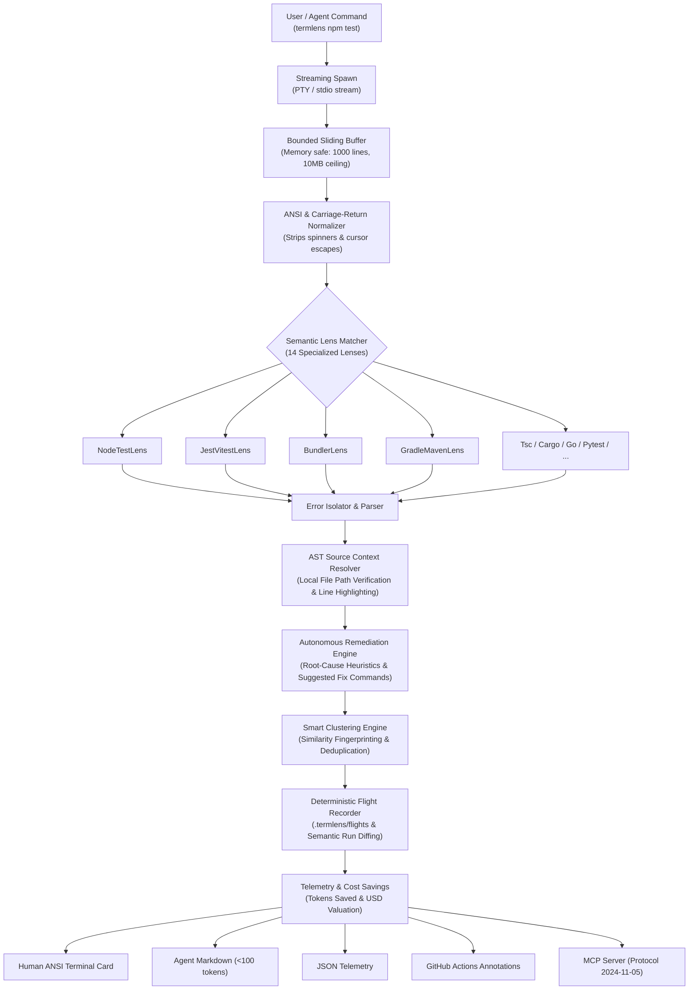

<div align="center">


<br/>

```
  ████████╗███████╗██████╗ ███╗   ███╗██╗     ███████╗███╗   ██╗███████╗
  ╚══██╔══╝██╔════╝██╔══██╗████╗ ████║██║     ██╔════╝████╗  ██║██╔════╝
     ██║   █████╗  ██████╔╝██╔████╔██║██║     █████╗  ██╔██╗ ██║███████╗
     ██║   ██╔══╝  ██╔══██╗██║╚██╔╝██║██║     ██╔══╝  ██║╚██╗██║╚════██║
     ██║   ███████╗██║  ██║██║ ╚═╝ ██║███████╗███████╗██║ ╚████║███████║
     ╚═╝   ╚══════╝╚═╝  ╚═╝╚═╝     ╚═╝╚══════╝╚══════╝╚═╝  ╚═══╝╚══════╝
```

### 🔍 Strip 90% Terminal Noise. Feed Clean Signal to AI.

[](https://dev.to/shenald/we-measured-1500-lines-of-terminal-bloat-burning-020-per-prompt-in-cursor-heres-how-we-1a4)
[](https://www.npmjs.com/package/termlens)
[](LICENSE)
[](https://nodejs.org/)
[](https://modelcontextprotocol.io/)
[](.github/workflows/ci.yml)

<p align="center">
  <b>A zero-token terminal compactor, deterministic incident flight recorder, and semantic error lens for developers and AI agents.</b><br/>
  Runs any build or test command, eliminates progress spinners and passing noise in memory, extracts local AST source code context, and isolates exact actionable failure blocks (<100 tokens) before they drain your LLM context window.
</p>

</div>

---

## ⚡ The 5-Second Problem & Solution

When you or your AI coding agent (Claude Code, Cursor, Codex, Gemini CLI, Aider) execute tests or builds, the terminal spews hundreds of lines of ANSI spinners, passing suites, and bloated stack traces. 

**An AI agent consumes all 1,500 lines.** This drains \$0.05–\$0.20 in API tokens *per command*, fills 60–80% of the attention window, and causes immediate context amnesia and hallucinations.

```
┌──────────────────────────────────────────────┐       ┌──────────────────────────────────────────────┐
│        BEFORE: WITHOUT TERMLENS              │       │          AFTER: WITH TERMLENS                │
├──────────────────────────────────────────────┤       ├──────────────────────────────────────────────┤
│  PASS src/math.test.ts (1.2s)                │       │  🔍 termlens v0.3.0 [lens: jest] [flight]    │
│  PASS src/string.test.ts (0.8s)              │       │  ──────────────────────────────────────────  │
│  PASS src/auth/hash.test.ts (2.1s)           │       │  ✗ FAILED (exit 1) npm test                  │
│  PASS src/database/client.test.ts (3.4s)     │  ──►  │    1 test failure isolated                   │
│  ... [84 passing tests hidden]               │       │                                              │
│  FAIL src/auth/jwt.test.ts (4.1s)            │       │  [#1] src/auth/jwt.test.ts:42:29             │
│    ● should reject expired token signature   │       │      Expected: 401                           │
│      Expected: 401, Received: 200            │       │      Received: 200                           │
│      at Object.<anonymous> (...)             │       │      Source Context:                         │
│      at Promise.then.completed (...)         │       │      > 42 | expect(response.status).toBe(401)│
│  ... [400 lines of node_modules stack trace] │       │  ──────────────────────────────────────────  │
│  Test Suites: 1 failed, 10 passed            │       │  ⏱️ 842ms │ 📉 1,482 lines → 4 lines (-97.3%)│
│                                              │       │  Tokens: ~3,840 → ~74 tokens ($0.011 saved)  │
└──────────────────────────────────────────────┘       └──────────────────────────────────────────────┘
```

---

## 🌟 The 10x Breakthrough Capabilities

### 1. 🛫 Deterministic Incident Flight Recorder & Semantic Run Diff
In agent and developer feedback loops, errors evolve between runs. `termlens` automatically records each execution into a deterministic, lightweight flight log (`.termlens/flights/`) and gives you instant **Semantic Delta Diffing**:
- **Resolved Failures**: Errors fixed by your recent edit.
- **Regressions / New Failures**: Newly introduced bugs flagged immediately.
- **Persistent Failures**: Errors remaining across runs.

```bash
# Compare current run with the preceding run
termlens --diff-last npm test

# Compare two recorded flights directly
termlens flight diff flt_17316521_a1b2 flt_17316525_c3d4

# List historical flight records
termlens flight list
```

### 2. 🔬 Neuro-Symbolic AST & Source Context Resolver
Most compilers (`tsc`, `mypy`, `cargo`, `gcc`) output coordinate errors like `src/auth.ts:42:15` with zero code context. Previously, AI agents had to burn an entire extra tool-calling turn invoking `read_file`.  
`termlens` automatically inspects local files safely (with path-traversal guards and bounded memory caching) and embeds the highlighted target lines (`> 42 | ...`) directly into the failure card.

### 3. 🧠 Autonomous Diagnostic & Remediation Engine
Detects root causes across 9 diagnostic categories and synthesizes instant copy-pasteable fix commands:
- **Missing Packages**: `Cannot find module 'foo'` ➔ `npm install foo` or `pip install foo`
- **TypeScript Mismatches**: `TS2322`, `TS2339` ➔ Interface adjustment or optional chaining suggestion
- **Unsynchronized Modules**: Go missing imports ➔ `go mod tidy`
- **Linter Violations**: ESLint, Biome, Ruff ➔ Auto-fix commands (`npx eslint --fix .`)
- **Port Collisions**: `EADDRINUSE` ➔ Process termination and port alternation recipes
- **Heap Exhaustion**: V8 OOM ➔ `NODE_OPTIONS="--max-old-space-size=4096"`

---

## 🚀 Instant Zero-Install Quickstart

Run any command through `termlens` using `npx`:

```bash
# Run Node.js native test runner
npx termlens node --test

# Run Jest / Vitest test suites
npx termlens npm test

# Run Modern Web Bundlers (Vite, Next.js, Webpack)
npx termlens vite build
npx termlens next build

# Run Go tests or builds
npx termlens go test ./...

# Run Python Pytest suites or linters (Ruff / Mypy / Flake8)
npx termlens pytest tests/
npx termlens ruff check .

# Run JavaScript / TypeScript linters (ESLint / Biome)
npx termlens npx eslint src/

# Run TypeScript compiler checks
npx termlens tsc --noEmit

# Run Java / Kotlin Gradle or Maven builds
npx termlens ./gradlew test
npx termlens mvn test

# Run C/C++ builds (Make, CMake, GCC, Clang)
npx termlens make -j4

# Run .NET tests or builds
npx termlens dotnet test

# Run Rust Cargo checks or tests
npx termlens cargo test

# Run Docker container builds
npx termlens docker build .
```

Or install globally for lightning-fast everyday terminal usage:

```bash
npm install -g termlens
termlens npm test
```

---

## 🤖 Output Modes

### 1. Human Developer Mode (Default)
Renders a modern, distraction-free ANSI terminal card with color-coded badges, clickable file links (`file:line:col`), highlighted source context snippets, flight delta indicators, and real-time token telemetry.

```bash
termlens npm test
```

### 2. AI Agent Mode (`-a, --agent`)
Generates an ultra-dense, token-optimized Markdown payload (<100 tokens) ready to inject straight into LLM prompt contexts:

```bash
termlens -a npm test
```

**Agent Output Example:**
```markdown
### ✗ Command Failed (exit 1): `npm test`
- **Lens**: jest
- **Summary**: 1 test failure isolated

**Isolated Failures:**
1. **`src/auth/jwt.test.ts:42:29`**: Test assertion failure
   - Expected: `401`
   - Received: `200`
   ```
   > 42 | expect(response.status).toBe(401);
   ```

**Action Item**: Fix the isolated failing assertions in the cited test suites.

*(termlens reduced 1482 lines to 4 lines: -97.3% tokens (~$0.0114 saved))*
```

### 3. Machine-Readable JSON Mode (`-j, --json`)
Outputs fully structured telemetry, error arrays, clusters, remediations, and flight metadata for programmatic pipelines:

```bash
termlens -j npm test
```

---

## 🔌 Model Context Protocol (MCP) Integration (Protocol 2024-11-05)

`termlens` includes a built-in, native **Model Context Protocol (MCP)** server over standard I/O. Any AI coding agent (Claude Code, Cursor, Codex, Antigravity) can execute shell commands through `termlens` with automatic token compression!

### Claude Code / Cursor Configuration

Add `termlens` to your `mcpServers` configuration (`claude_desktop_config.json` or `.cursor/mcp.json`):

```json
{
  "mcpServers": {
    "termlens": {
      "command": "npx",
      "args": ["-y", "termlens", "--mcp"]
    }
  }
}
```

### MCP Tools

| Tool | Parameters | Description |
| :--- | :--- | :--- |
| `termlens_exec` | `command`, `lens`, `cwd`, `timeoutMs`, `quietSuccess`, `maxErrors`, `diffWithLast`, `enrichSource` | Executes shell command with automated token compaction, AST source snippet enrichment, and flight recording. |
| `termlens_compact` | `text`, `lens`, `quietSuccess`, `enrichSource` | Compacts raw terminal text blocks or log traces on the fly without spawning processes. |
| `termlens_suggest_fix` | `error`, `command`, `file`, `line`, `snippet` | Generates autonomous remediation plans, patch hypotheses, and repair commands. |
| `termlens_diff` | `baseFlightId`, `targetFlightId` | Semantically diffs two execution runs to isolate resolved bugs and introduced regressions. |
| `termlens_flight_inspect`| `flightId` (default: "latest") | Retrieves full flight execution telemetry and failure records. |
| `termlens_list_lenses` | *None* | Lists all 14 available built-in and user-defined semantic lenses. |
| `termlens_explain` | `error`, `file`, `snippet` | Provides structured failure analysis, probable root cause, and remediation guidance. |

### MCP Resources

- `termlens://flights/latest`: Telemetry and failure records for the most recent command execution.
- `termlens://flights/{id}`: Telemetry and failure records for a specific historical flight.
- `termlens://lenses`: Complete schema of all registered semantic lenses and supported ecosystems.

---

## 🔬 Registered Semantic Lenses (14 Total)

| Lens | Triggered By | What It Strips | What It Isolates |
| :--- | :--- | :--- | :--- |
| **`node-test`** | `node --test`, TAP logs | Passing subtest blocks, TAP headers, timing lines | Failed subtest names, assertion differences, stack coordinates |
| **`jest` / `vitest`** | `jest`, `vitest`, `npm test` | Passing suites, spinner frames, `node_modules` frames | Failed suite path, exact assertion, `Expected vs Received`, code snippet |
| **`bundler`** | `vite`, `next`, `webpack`, `rollup`, `esbuild` | Module resolution chatter, HMR updates | Vite/Webpack internal errors, missing module paths, syntax line |
| **`gradle-maven`** | `./gradlew`, `gradle`, `mvn` | Task dependency trees, daemon logs | Java/Kotlin compiler diagnostics (`[ERROR]`), failed task, JUnit failures |
| **`pytest`** | `pytest`, `python -m pytest` | Session banners, rootdir prints, passed dots (`...`) | Failed function name, `AssertionError` line, failure traceback |
| **`tsc`** | `tsc`, `typecheck` | Redundant build text, empty lines | Groups errors by file path, `TSxxxx` code, file location (`file:line:col`) |
| **`cargo`** | `cargo test`, `cargo build` | `Compiling...`, crate downloads | `error[E0xxx]` headers, code location (`--> src/main.rs:12:9`) |
| **`docker`** | `docker build`, `podman` | Intermediate layer transfer hashes (`#4 CACHED`) | Exact failed Dockerfile step, command failure code |
| **`go`** | `go test`, `go build`, `go vet` | PASS benchmarks, directory banners, runtime internals | Failed test name, assertion message, panic trace, compile line |
| **`python-lint`** | `ruff`, `mypy`, `flake8` | Success stats, file tree scanning logs | Violation code (`F401`, `E501`), file coordinates, mypy type errors |
| **`js-lint`** | `eslint`, `biome` | Passing file trees, configuration logs | ESLint/Biome rule name, severity, exact line:column |
| **`clang`** | `gcc`, `clang`, `make`, `cmake` | Build step banners, include search paths | Compiler error/warning, diagnostic code snippet, caret pointer |
| **`dotnet`** | `dotnet test`, `dotnet build` | MSBuild project headers, passing test classes | `CSxxxx` error code, failed test namespaces, assertion failures |
| **`generic`** | *Universal fallback* | Progress bars, blank lines, uninformative logs | Root cause error line, uncaught exceptions, top 3 stack frames |

---

## 📊 Empirical Benchmarks

Reproducible benchmarks executed via `npm run benchmark` across realistic workloads:

| Workload | Raw Lines | Compact Lines | Raw Tokens | Compact Tokens | Token Reduction | Processing Latency |
| :--- | :---: | :---: | :---: | :---: | :---: | :---: |
| **Node.js TAP (151 subtests, 1 fail)** | 917 | 15 | 3,715 | 124 | **-96.7%** | **0.12 ms** |
| **Gradle / Java Build (60 tasks)** | 116 | 10 | 1,277 | 119 | **-90.7%** | **0.11 ms** |
| **Vite Bundler HMR Log (80 modules)** | 127 | 20 | 1,753 | 217 | **-87.6%** | **0.14 ms** |
| **Docker Multi-Stage Build** | 31 | 8 | 278 | 62 | **-77.7%** | **0.09 ms** |
| **Jest 85-Test Suite (1 fail)** | 64 | 17 | 725 | 178 | **-75.4%** | **0.11 ms** |

- **Streaming Throughput:** 486,852 lines/sec (~20.01 MB/sec)
- **Median Latency (p50):** 0.114 ms (p95: 0.228 ms, p99: 0.351 ms)
- **Memory Footprint:** 0.90 MB heap delta on 50,000 continuous log lines
- **Semantic Run Diff:** 0.0143 ms per comparison (>200,000 diffs/sec)

---

## 🏗️ Architecture



---

## 🛠️ CLI Reference Manual

```text
Usage: termlens [options] <command...>
       termlens flight <list|show|diff>
       cat noisy.log | termlens [options]

Examples:
  termlens npm test
  termlens -a pytest tests/
  termlens -q go test ./...
  termlens -j tsc --noEmit
  termlens --diff-last npm test
  termlens --ci cargo test
  termlens flight list
  termlens flight diff <flight1> <flight2>
  termlens --init
  termlens --mcp

Options:
  -a, --agent          Format output as ultra-compact Markdown for AI agent prompts
  -j, --json           Format output as structured JSON
  -q, --quiet-success  Suppress output on exit 0 (zero tokens for AI agents on green runs)
  --ci                 Output GitHub Actions workflow commands (::error file=...::...)
  --diff-last          Semantically diff current run against the previous recorded flight
  --diff-with <id>     Semantically diff current run against a specific flight recording
  --no-source          Disable automatic AST source code context extraction
  --no-flight          Disable incident flight recording to .termlens/flights
  -l, --lens <name>    Explicitly specify a lens (node-test, jest, pytest, tsc, bundler,
                       go, python-lint, js-lint, clang, dotnet, gradle-maven, cargo, docker, generic)
  -o, --output <file>  Write formatted output to a file
  --tail <lines>       Number of raw tail lines to retain in output (default: 8)
  --max-errors <n>     Max errors to display before clustering (default: 8)
  --no-cluster         Disable error deduplication and clustering
  --init               Scaffold a termlens.config.json configuration file
  --raw                Pass through uncompressed output (dry/debug mode)
  --mcp                Start the Model Context Protocol (MCP) stdio server
  --list-lenses        List all registered semantic lenses
  -v, --version        Display current version
  -h, --help           Display this help manual
```

---

## 🧪 Testing & Verification

```bash
# Verify TypeScript build
npm run build

# Run lint & typecheck
npm run lint

# Run all 62 automated tests
npm test

# Run empirical performance benchmarks
npm run benchmark
```

---

## 📄 License

MIT © [Shenal Diluksha](https://github.com/shenald-dev) (`shenald-dev`)
