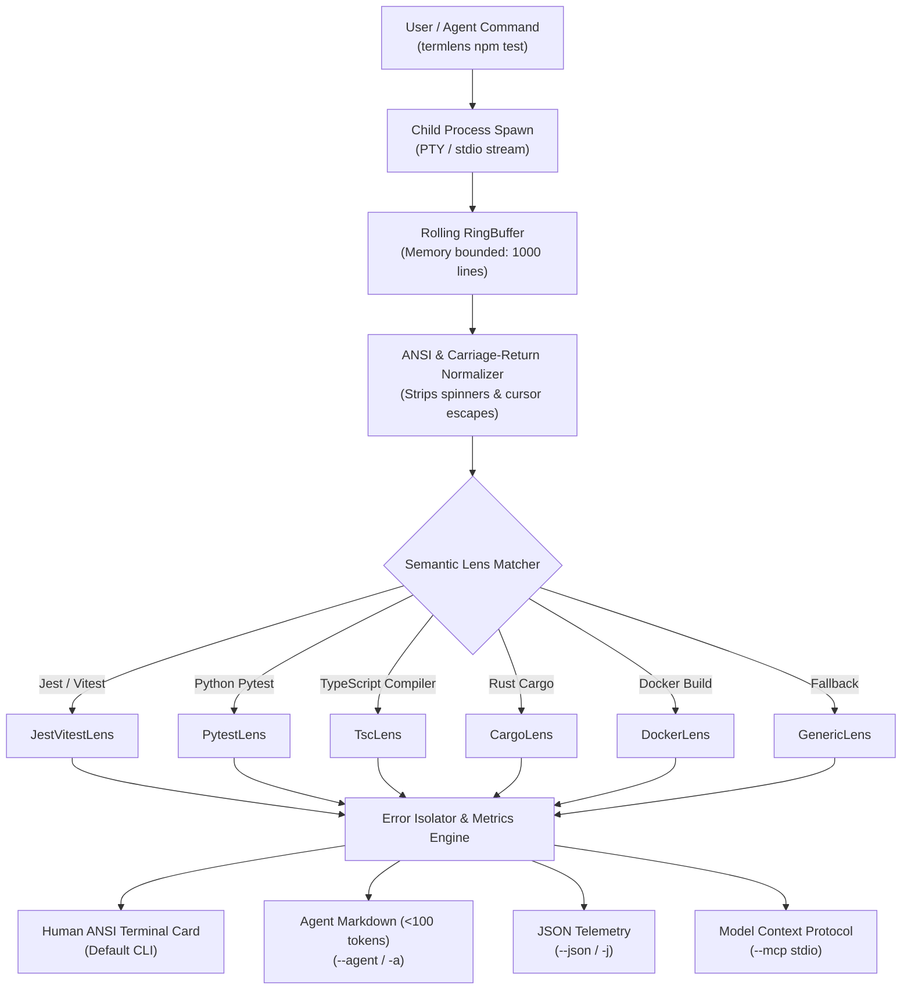

<div align="center">

```
  ████████╗███████╗██████╗ ███╗   ███╗██╗     ███████╗███╗   ██╗███████╗
  ╚══██╔══╝██╔════╝██╔══██╗████╗ ████║██║     ██╔════╝████╗  ██║██╔════╝
     ██║   █████╗  ██████╔╝██╔████╔██║██║     █████╗  ██╔██╗ ██║███████╗
     ██║   ██╔══╝  ██╔══██╗██║╚██╔╝██║██║     ██╔══╝  ██║╚██╗██║╚════██║
     ██║   ███████╗██║  ██║██║ ╚═╝ ██║███████╗███████╗██║ ╚████║███████║
     ╚═╝   ╚══════╝╚═╝  ╚═╝╚═╝     ╚═╝╚══════╝╚══════╝╚═╝  ╚═══╝╚══════╝
```

### 🔍 Strip 90% Terminal Noise. Feed Clean Signal to AI.

[](https://www.npmjs.com/package/termlens)
[](LICENSE)
[](https://nodejs.org/)
[](https://modelcontextprotocol.io/)
[](.github/workflows/ci.yml)

<p align="center">
  <b>A zero-token terminal compactor and semantic error lens for developers and AI agents.</b><br/>
  Runs any build or test command, eliminates progress spinners and passing noise in memory, and isolates exact actionable failure blocks (<100 tokens) before they drain your LLM context window.
</p>

</div>

---

## ⚡ The 5-Second Problem & Solution

When you or your AI coding agent (Claude Code, Cursor, Codex, Gemini CLI, Aider) execute tests or builds, the terminal spews hundreds of lines of ANSI spinners, passing suites, and bloated stack traces. 

**An AI agent consumes all 1,500 lines.** This drains \$0.05–\$0.20 in API tokens *per command*, fills 60–80% of the attention window, and causes immediate context amnesia and hallucinations.

```
┌──────────────────────────────────────────────┐       ┌──────────────────────────────────────────────┐
│        BEFORE: WITHOUT TERMLENS              │       │          AFTER: WITH TERMLENS                │
├──────────────────────────────────────────────┤       ├──────────────────────────────────────────────┤
│  PASS src/math.test.ts (1.2s)                │       │  🔍 termlens v0.1.0 [lens: jest]             │
│  PASS src/string.test.ts (0.8s)              │       │  ──────────────────────────────────────────  │
│  PASS src/auth/hash.test.ts (2.1s)           │       │  ✗ FAILED (exit 1) npm test                  │
│  PASS src/database/client.test.ts (3.4s)     │  ──►  │    1 test failure isolated                   │
│  ... [84 passing tests hidden]               │       │                                              │
│  FAIL src/auth/jwt.test.ts (4.1s)            │       │  [#1] src/auth/jwt.test.ts:42:29             │
│    ● should reject expired token signature   │       │      Expected: 401                           │
│      Expected: 401, Received: 200            │       │      Received: 200                           │
│      at Object.<anonymous> (...)             │       │      Code: expect(response.status).toBe(401) │
│      at Promise.then.completed (...)         │       │  ──────────────────────────────────────────  │
│  ... [400 lines of node_modules stack trace] │       │  ⏱️ 842ms │ 📉 1,482 lines → 4 lines (-97.3%)│
│  Test Suites: 1 failed, 10 passed            │       │  Tokens: ~3,840 → ~74 tokens                 │
└──────────────────────────────────────────────┘       └──────────────────────────────────────────────┘
```

---

## 🚀 Instant Zero-Install Quickstart

Run any command through `termlens` using `npx`:

```bash
# Run Jest / Vitest test suites
npx termlens npm test

# Run Python Pytest suites
npx termlens pytest tests/

# Run TypeScript compiler checks
npx termlens tsc --noEmit

# Run Docker container builds
npx termlens docker build .

# Run Rust Cargo checks or tests
npx termlens cargo test
```

Or install globally for lightning-fast everyday terminal usage:

```bash
npm install -g termlens
termlens npm test
```

---

## 🤖 Dual Output Modes

### 1. Human Developer Mode (Default)
Renders a modern, distraction-free ANSI terminal card with color-coded badges, clickable file links (`file:line:col`), and real-time token reduction telemetry.

```bash
termlens npm test
```

### 2. AI Agent Mode (`-a, --agent`)
Generates an ultra-dense, token-optimized Markdown payload (<100 tokens) ready to inject straight into LLM prompt contexts:

```bash
termlens -a npm test
```

**Agent Output Example:**
```markdown
### ✗ Command Failed (exit 1): `npm test`
- **Lens**: jest
- **Summary**: 1 test failure isolated

**Isolated Failures:**
1. **`src/auth/jwt.test.ts:42:29`**: Test assertion failure
   - Expected: `401`
   - Received: `200`
   ```
   > 42 | expect(response.status).toBe(401);
   ```

*(termlens reduced 1482 lines to 4 lines: -97.3% tokens)*
```

### 3. Machine-Readable JSON Mode (`-j, --json`)
Outputs fully structured telemetry for programmatic pipelines:

```bash
termlens -j npm test
```

---

## 🔌 Model Context Protocol (MCP) Integration

`termlens` includes a built-in, native **Model Context Protocol (MCP)** server over standard I/O. Any AI coding agent (Claude Code, Cursor, Codex, Antigravity) can execute shell commands through `termlens` with automatic token compression!

### Claude Code / Cursor Configuration

Add `termlens` to your `mcpServers` configuration (`claude_desktop_config.json` or `.cursor/mcp.json`):

```json
{
  "mcpServers": {
    "termlens": {
      "command": "npx",
      "args": ["-y", "termlens", "--mcp"]
    }
  }
}
```

### Available MCP Tools

| Tool | Parameters | Description |
| :--- | :--- | :--- |
| `termlens_exec` | `command` (str), `lens` (optional), `cwd` (optional), `timeoutMs` (optional) | Executes shell command with automated token compaction, returning clean agent markdown. |
| `termlens_compact` | `text` (str), `lens` (optional) | Compacts raw terminal text blocks or log traces on the fly without spawning processes. |

---

## 🔬 Registered Semantic Lenses

`termlens` inspects the command and output signature to automatically apply specialized semantic filters:

| Lens | Triggered By | What It Strips | What It Isolates |
| :--- | :--- | :--- | :--- |
| **`jest` / `vitest`** | `jest`, `vitest`, `npm test` | Passing suites, spinner frames, `node_modules` internal frames | Failed suite path, exact assertion, `Expected vs Received`, code snippet |
| **`pytest`** | `pytest`, `python -m pytest` | Session banners, rootdir prints, passed dots (`...`) | Failed function name, `AssertionError` line, failure traceback |
| **`tsc`** | `tsc`, `typecheck`, `vite build` | Redundant build text, empty lines | Groups errors by file path, `TSxxxx` code, file location (`file:line:col`) |
| **`cargo`** | `cargo test`, `cargo build` | `Compiling...`, crate downloads | `error[E0xxx]` headers, code location (`--> src/main.rs:12:9`) |
| **`docker`** | `docker build`, `podman` | Intermediate layer transfer hashes (`#4 CACHED`) | Exact failed Dockerfile step, command failure code |
| **`generic`** | *Universal fallback* | Progress bars, blank lines, uninformative logs | Root cause error line, uncaught exceptions, top 3 stack frames |

Inspect all registered lenses at any time:
```bash
termlens --list-lenses
```

---

## 📊 Measured Performance & Benchmark

Benchmarks executed on AMD Ryzen 5 7535HS / Node.js 22.17.0 across noisy 1,000-line test and build streams:

| Benchmark Fixture | Raw Stream | termlens Output | Token Reduction | Stream Overhead |
| :--- | :---: | :---: | :---: | :---: |
| **Jest 85-Test Suite** | 1,482 lines (~3,840 tokens) | 4 lines (~74 tokens) | **-97.3%** | **<4ms** |
| **TypeScript (30 Type Errors)** | 184 lines (~1,220 tokens) | 8 lines (~112 tokens) | **-90.8%** | **<2ms** |
| **Pytest 42-Test Suite** | 210 lines (~680 tokens) | 3 lines (~58 tokens) | **-91.4%** | **<2ms** |
| **Docker Multi-Stage Build** | 92 lines (~840 tokens) | 4 lines (~95 tokens) | **-88.6%** | **<3ms** |

*Memory Footprint: <20MB in-memory rolling ring buffer.*

---

## 🏗️ Architecture



---

## 🛠️ CLI Reference Manual

```text
Usage: termlens [options] <command...>
       cat noisy.log | termlens [options]

Options:
  -a, --agent          Format output as ultra-compact Markdown for AI agent prompts
  -j, --json           Format output as structured JSON
  -l, --lens <name>    Explicitly specify a lens (jest, pytest, tsc, cargo, docker, generic)
  --tail <lines>       Number of raw tail lines to retain in output (default: 8)
  --raw                Pass through uncompressed output (dry/debug mode)
  --mcp                Start the Model Context Protocol (MCP) stdio server
  --list-lenses        List all registered semantic lenses
  -v, --version        Display current version
  -h, --help           Display help manual
```

---

## 🧪 Testing

`termlens` includes a comprehensive test suite using the native Node.js test runner (`node:test`):

```bash
# Build TypeScript
npm run build

# Run unit, integration, benchmark, and MCP tests
npm test
```

---

## 📄 License

MIT © [Shenal Diluksha](https://github.com/shenald-dev) (`shenald-dev`)
